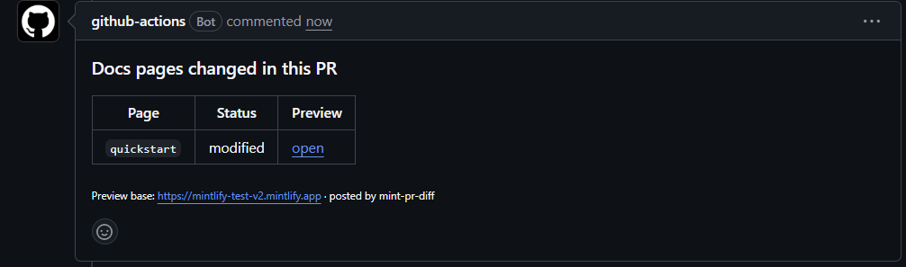

# mint-pr-diff

A GitHub Action that comments which Mintlify docs pages changed in a pull request, with a preview link for each one.

Mintlify builds a preview for every PR, but reviewers have to work out which pages to look at by reading the diff. This action posts one sticky comment with a table of changed pages, their status, and a link straight to each page on the preview.



## Usage

```yaml
# .github/workflows/docs-diff.yml
name: docs diff
on:
  pull_request:
    paths: ["docs/**"]
permissions:
  pull-requests: write
  contents: read
jobs:
  diff:
    runs-on: ubuntu-latest
    steps:
      - uses: prithsk/mint-pr-diff@v0.1.0
        with:
          docs_path: docs
          preview_base_url: https://${{ github.event.repository.name }}-${{ github.head_ref }}.mintlify.app
```

If your docs live at the repo root, drop `docs_path`.

## Inputs

| Input | Required | Default | What it does |
|---|---|---|---|
| `preview_base_url` | yes | | Base URL of the preview deployment for this branch. |
| `docs_path` | no | `.` | Folder that holds `docs.json` and your pages. |
| `github_token` | no | `${{ github.token }}` | Needs `pull-requests: write`. |
| `comment_when_empty` | no | `false` | Post a comment even when no pages changed. |

## Outputs

| Output | What it is |
|---|---|
| `changed_count` | Number of pages changed. |
| `changed_slugs` | Comma-separated slugs, for downstream steps. |

## How slugs are computed

The action maps file paths to URLs the way Mintlify does.

- `quickstart.mdx` → `/quickstart`
- `guides/index.mdx` → `/guides`
- `index.mdx` → `/`
- A change to `docs.json` or `mint.json` is flagged separately since it moves pages around without changing their files.

## Preview URL

Mintlify's branch previews follow `https://<project>-<branch>.mintlify.app` for GitHub-connected projects. Pass whatever your project uses. The action doesn't guess.

## Sticky comment

The comment carries a hidden marker. On every push the action finds its own earlier comment and edits it instead of posting a new one.

## Development

```
npm install
npm test      # unit tests for slug mapping and rendering
npm run build # bundles to dist/ with ncc
```

Dependencies are pinned to exact versions.

## License

MIT
